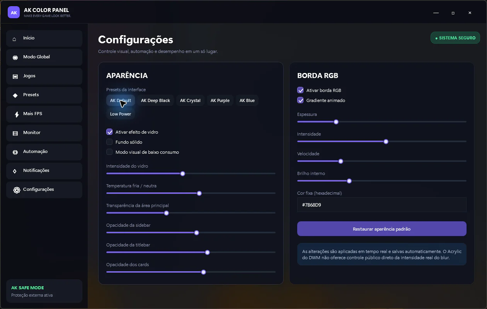
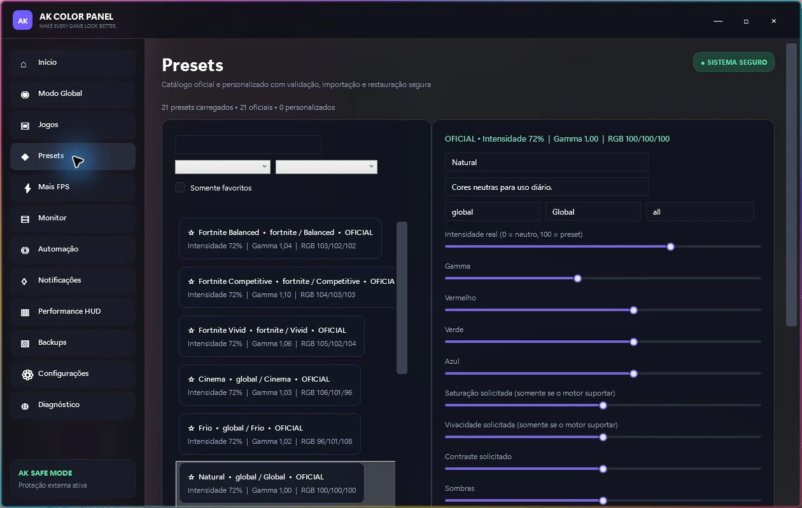

# AK Color Panel — Windows Display Profiles

Display settings and game-specific preferences vary across hardware. AK Color Panel brings color profiles and session tools into a Windows interface with capability detection, explicit operation results and restoration paths.

**Documentation-only engineering case study. Source code remains proprietary.**

## What was developed

- Per-monitor SDR gamma/RGB adjustment, intensity control, original-state capture and restoration.
- Global/game profiles, executable associations and session-driven application/restoration.
- HDR state detection and safeguards for unsupported display paths.
- Conditional DDC/CI brightness/contrast and ICC association; hardware support is required.
- Windows appearance settings and external performance HUD infrastructure.

## Technology and technical decisions

C#, .NET 10, WPF/XAML, MVVM, dependency injection, Win32 interoperability, JSON persistence, asynchronous services and xUnit. Current source identity: 0.9.0-preview.7, internal beta.

Capability-aware adapters avoid presenting every slider as an effective hardware operation. Original-state backups and readback support reversible changes. Cancellation and serialized updates help keep rapid UI interaction consistent.

## Validation

Recorded local verification from **October 29, 2026** (earlier runs, reviewed for this package):

| Check | Result |
|---|---|
| Release solution build, --no-restore | PASS; 0 warnings and 0 errors |
| Selected xUnit HDR/color suites | 68 passed, 0 failed, 0 skipped |
| Hardware validation | Not rerun; selected tests use fake providers and temporary state |

Tests describe the exercised paths, not production usage or complete security coverage.

## Interface

Owner-approved historical development screenshots in Portuguese. They predate the current internal beta; visible controls do not establish hardware support. Preset values are part of the specifically approved images.

## Development role

Portfolio owner and developer: **Studio Dev (@Studiodev00)**, as identified by the owner of this project. This case study presents implementation and verification evidence. It does not attribute every module exclusively to one person or establish employment, team size or business results from commit history.

## Current boundaries

Windows and compatible hardware are required. SDR gamma is not universal digital saturation/vibrance. The MHC2 path reports unsupported in the inspected implementation. DDC/CI depends on monitor, connection and driver capabilities. Physical HDR and broad vendor compatibility are not certified. Historical stability observations did not rule out memory/handle growth. No FPS improvement is promised.

## Source and demonstration availability

This repository contains selected documentation and images only. It is not a buildable source distribution and grants no license to the private application. No binaries, production data or credentials are included. Screenshots appear in the Interface section; a supervised demonstration can be discussed with the project owner. No public application demo has been confirmed for this snapshot.

[Architecture](docs/ARCHITECTURE.md) · [Verified features](docs/FEATURES.md) · [Testing](docs/TESTING.md) · [Security](docs/SECURITY.md) · [Publication review](PUBLICATION_REVIEW.md)

No project source code may be uploaded to GitHub, publicly or privately. Only explicitly approved documentation and authorized images are eligible for publication.
